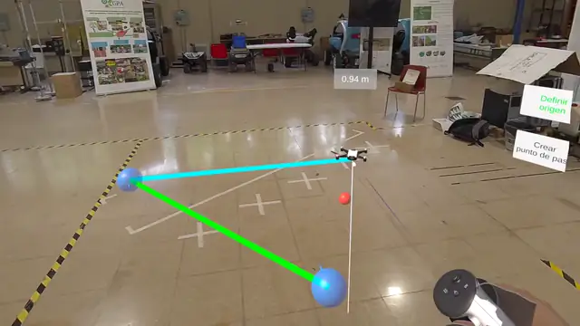
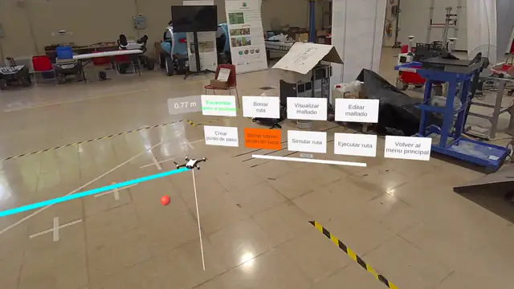
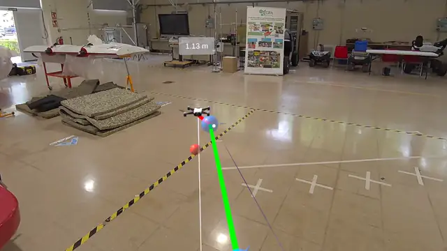
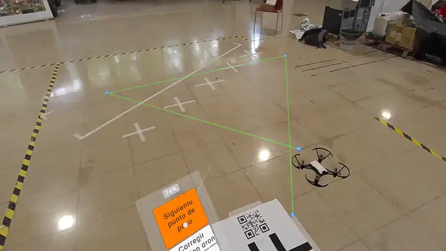
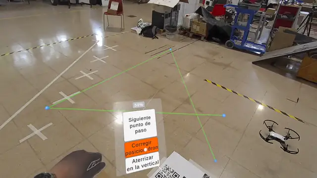

# Mixed Reality Interface for Drone Teleoperation by Users with No Piloting Experience

*[Versión en español](README.es.md)*

Mixed Reality application for **Meta Quest** to plan, simulate and supervise the
flight of a **DJI Tello** drone inside the user's real physical space. The operator
places waypoints in their own room, checks that the path is safe and then runs the
mission on the physical drone, which they supervise by sight and can correct at
each waypoint.

> Master's Thesis · Universidad Carlos III de Madrid (UC3M) · Author: **Jaime Provencio Solís** · 2026

<p align="center">
  
  <br>
  <em>Route planning over the real space: confirmed segments in green, the candidate segment in cyan, with its height shown.</em>
</p>

---

## What it does

- **Spatial calibration.** The system's coordinate origin is anchored to a printed
  QR marker, so the virtual world and the real world share the same reference frame.
- **Route planning.** The user places waypoints in mid-air with the Quest
  controllers. Each segment is validated on the spot against three criteria, in this
  order: the minimum movement step the Tello accepts (at least 20 cm on some axis)
  together with a minimum height above the floor, a cylindrical *geofence* (maximum
  radius and height), and volumetric collision of the segment against the mesh of
  the real environment.
- **Pre-flight simulation.** A "ghost drone" flies the route virtually so the path
  can be reviewed without risk before the real flight.
- **Physical execution.** The mission is translated into Tello commands and sent
  over UDP. Execution is open-loop: the system does not know the drone's real
  position, and the only telemetry it reads is the battery level. Optionally, the
  headset records the drone's camera video (raw H.264 stream, converted to MP4 on a
  computer).
- **Assisted correction.** After each segment, the operator can reposition the drone
  with a visual aid that respects the Tello's minimum movement step (20 cm per axis).

---

## Demo

<table>
  <tr>
    <td width="50%"><br><b>Environment mesh.</b> The headset's scan of the room, used to check the route for collisions.</td>
    <td width="50%"><br><b>Segment validation.</b> Red: the waypoint is too close to the previous one or to the floor. Pink: the segment collides with the real environment.</td>
  </tr>
  <tr>
    <td width="50%"><br><b>Execution.</b> The real drone flies the route and stops at each waypoint until the operator chooses: next waypoint, correct position or land.</td>
    <td width="50%"><br><b>Assisted correction.</b> A virtual drone appears where the real one should be. The operator drags it onto the real drone (it turns green when the move is valid) and the drone flies back to its planned position.</td>
  </tr>
</table>

▶ **[Full demo video (1:40)](docs/media/demo_full.mp4)**: mesh, planning, validation, take-off, flight, landing and correction.

> Footage recorded from the headset during testing. The interface is shown in Spanish.

---

## Architecture

The code is organised in layers, each with a single responsibility. Each folder in
`Assets/Scripts/` is one layer:

| Layer | Folder | Responsibility |
|-------|--------|----------------|
| 1 | `1_Core_Espacial` | Origin calibration and marker → drone anchoring. |
| 2 | `2_Planificacion_Virtual` | Waypoints, validation (geofence) and route simulation. |
| 3 | `3_Interaccion_HMI` | VR interaction: canvas, height, rotation, visual aids. |
| 4 | `4_Maquina_Estados` | Drone state machine and localisation (language). |
| 5 | `5_Comunicaciones_Fisicas` | UDP link with the Tello, telemetry, recording and correction. |
| 6 | `6_Entorno_MRUK` | Integration with the Quest's environment (Meta MR Utility Kit). |
| — | `Pruebas` | Test setup builder and manual flight mode. |

The overall flow is: **calibrate → plan and validate → simulate → execute on the drone → supervise and correct at each waypoint**.

> **Note:** the source code (folder, class and variable names, and comments) is
> written in Spanish.

---

## Requirements

**Software**

- [Unity **6000.4.3f1**](https://unity.com/releases/editor/archive) (Unity 6). Other
  minor versions may work, but the project was developed and tested with this one.
- Main packages (installed automatically when the project is opened, through the
  *Package Manager*):
  - Meta XR SDK (`com.meta.xr.sdk.all` 85.0.0)
  - Universal Render Pipeline (URP 17.4)
  - XR Interaction Toolkit 3.4 · OpenXR · XR Management
  - ProBuilder

**Hardware**

- **Meta Quest** headset (developed on a Quest with passthrough / Mixed Reality).
- **DJI Tello** drone connected over Wi-Fi for physical execution (optional:
  planning and simulation work without the drone).

---

## How to open the project

1. Clone the repository:
   ```bash
   git clone https://github.com/saidlab-team/TFM-MR-Drone-Teleoperation-Unity.git
   ```
2. Open it from **Unity Hub** with version `6000.4.3f1`. The first time, Unity will
   regenerate the `Library/` folder (it is not in the repository; this is normal and
   may take a while).
3. Open the main scene: `Assets/Scenes/Simulador_VR_Quest.unity`.
4. To deploy to the Quest, use *Build & Run* with the **Android** platform and the
   headset connected.

> **Note:** this repository contains the project's **source code and assets**. It
> does not include compiled builds (`.apk`), the Unity cache (`Library/`) or
> editor-generated files; all of that is rebuilt when the project is opened.

---

## Basic use

The interface starts in English and can be switched to Spanish with the in-app
language button.

To fly the real drone, the headset must be connected to the Tello's own Wi-Fi
network (the drone creates it when switched on); inside the application, the
**Connect** button opens the link. From there, the operating flow is:

1. **Calibrate the origin.** The printed QR marker is scanned with the headset. The
   system sets the common coordinate origin for the real and virtual space, and
   places the holographic drone at the take-off point.
2. **Define the route.** Waypoints are placed over the real space from the menu.
   Each segment is validated on the spot and the line changes colour according to
   the result: cyan if it is valid, pink if the path collides with the environment
   mesh, dark blue if it leaves the *geofence*, and red if the waypoint is too close
   to the previous one or to the floor (below the minimum the drone accepts).
3. **Simulate (optional).** A ghost drone flies the route virtually so it can be
   reviewed before the real flight.
4. **Execute.** After confirmation, the real drone takes off and flies the route
   segment by segment, stopping at each waypoint to wait for a decision: continue to
   the next one, correct the position, or land vertically.
5. **Manual mode** (comparison condition of the study). Lets the user pilot the drone
   directly with the controllers: the left *joystick* controls height and yaw, the
   right one controls forward and sideways movement, and the right controller's
   buttons handle take-off and landing.
6. **Test mode.** Generates the two scenarios of the study: a shelf (simple task,
   with the waypoints on a plane) or a two-level beam structure (complex 3D task,
   flying through the gaps), to practise with or evaluate the interface.

> The detailed operation, system design and results are described in the Master's
> Thesis, whose access is restricted to the UC3M university community.

---

## Project status

Project developed as a Master's Thesis. It is a **research prototype**, not a
finished product. The application works (planning, simulation and real flight
verified in tests with hardware), but it keeps the limitations of a Master's
Thesis. The limitations and future work are detailed in the thesis.

---

## License

Released under the **MIT** license. See the [LICENSE](LICENSE) file.

---

## Author

**Jaime Provencio Solís**. Master's Thesis, 2026.
